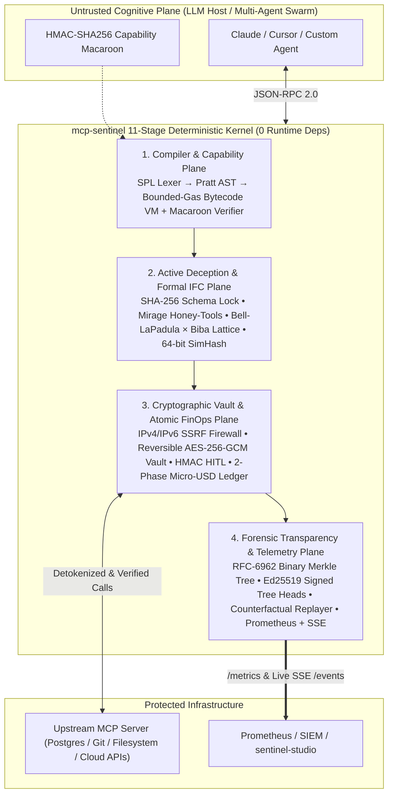

<div align="center">

# 🛡️ `mcp-sentinel`

**Zero-Dependency TypeScript Runtime Security Mesh & FinOps Firewall for MCP and AI Agents**

*Reversible AES-256-GCM PII Vault • Bell-LaPadula × Biba Lattice IFC • SPL Bytecode Policy VM • Attenuated Macaroons • Mirage Honey-Tools • 2-Phase Micro-USD Ledger • RFC-6962 Merkle Forensics*

[](https://github.com/truscotta/mcp-sentinel/actions/workflows/ci.yml)
[](./package.json)
[](./tsconfig.json)
[](./package.json)
[](./LICENSE)
[](https://github.com/sponsors/truscotta)

</div>

---

## Why 95% of AI Agents Break Between Demo and Production

Connecting an LLM to real databases, filesystems, and SaaS APIs via the **Model Context Protocol (MCP)** unlocks autonomous workflows—and immediately exposes four catastrophic production failure modes:

1. **The "Lethal Trifecta" Data Exfiltration:** An agent reads an untrusted GitHub issue or web page containing an indirect prompt injection, reads confidential customer records, and silently exfiltrates them through an outbound Slack or HTTP tool.
2. **Naive `[REDACTED]` Masking Breaks Tool Chains:** Traditional DLP proxies replace emails and payment cards with `[REDACTED]`. When the LLM tries to pass that customer record to the next legitimate internal tool, validation crashes.
3. **Mid-Session MCP Rug-Pulls & Tool Poisoning:** Untrusted MCP servers embed invisible Unicode tag instructions (`U+E0000..U+E007F`) inside `tools/list` descriptions or mutate schemas mid-session after initial user approval.
4. **Parallel Async Loops Burn Thousands of Dollars Overnight:** Post-call token counters cannot stop 25 concurrent `Promise.all` tool calls or subtle parameter-jitter loops from blowing past session budgets before the first invoice settles.

**`mcp-sentinel`** solves all four at the wire boundary—in **pure, zero-dependency Node.js (`0` external npm packages)**—as either a **1-line Stdio Reverse Proxy** for any MCP server (`Python`, `Go`, `Rust`, `Node`) or an **in-process TypeScript SDK**.

---

## How `mcp-sentinel` Compares

| Capability | Regex / Wrapper Proxies | Hosted SaaS AI Gateways | `mcp-sentinel` v1.0.0 |
| :--- | :--- | :--- | :--- |
| **Supply-Chain Attack Surface** | Dozens of transitive npm deps | Cloud vendor lock-in & data egress | **`0` runtime dependencies** (100% native `node:crypto` / `node:http`) |
| **PII & Secret Handling** | Destructive `[REDACTED]` strings | Plaintext sent to third-party cloud | **Bi-Directional AES-256-GCM Vault** (format-preserving aliases + Lattice detokenization) |
| **Toxic-Flow Prevention** | Static per-tool allow/deny lists | Prompt-based LLM judges (slow & bypassable) | **Bell-LaPadula × Biba Dual Security Lattice** + Causal Provenance DAG |
| **Policy Engine** | Ad-hoc YAML/JSON key matching | Proprietary cloud rules | **SPL Compiler → Bounded-Gas Stack Bytecode VM** + Static Conflict & ReDoS Analyzer |
| **Multi-Agent Delegation** | Static session API keys | Coarse RBAC roles | **Attenuated HMAC-SHA256 Macaroons** (offline sub-agent scope narrowing) |
| **Active Intrusion Detection** | Passive log review after breach | Heuristic anomaly alerts | **Mirage Honey-Tools & Canary Watermarks** (Base64/URL evasion scan + Kill-Switch) |
| **Loop & Spend Protection** | Exact string match + post-call sum | Delayed billing webhooks | **64-bit SimHash** ($O(1)$ Hamming) + **2-Phase Micro-USD Ledger** + **Welford/CUSUM** |
| **Compliance Audit Trail** | Mutable JSON/text log files | Proprietary dashboard retention | **RFC-6962 Binary Merkle Tree** ($O(\log_2 N)$ proofs) + **Ed25519 Signed Tree Heads** |

---

## Quickstart in 3 Lines

### Option 1: Wrap Any Existing MCP Server via CLI Proxy (Zero Code Changes)

```bash
npm install -g mcp-sentinel
mcp-sentinel keygen --out-dir ./keys
mcp-sentinel --mode ENFORCE --audit-log ./sentinel.audit.jsonl --metrics-port 9464 -- npx -y @modelcontextprotocol/server-postgres postgresql://localhost/mydb
```

Drop directly into **Claude Desktop** (`claude_desktop_config.json`) or **Cursor** (`.cursor/mcp.json`):

```json
{
  "mcpServers": {
    "postgres-governed": {
      "command": "npx",
      "args": [
        "-y",
        "mcp-sentinel",
        "--mode",
        "ENFORCE",
        "--audit-log",
        "./logs/postgres.audit.jsonl",
        "--",
        "npx",
        "-y",
        "@modelcontextprotocol/server-postgres",
        "postgresql://localhost:5432/production"
      ]
    }
  }
}
```

### Option 2: Embed Directly in TypeScript Agent Applications

```typescript
import {
  createDefaultPolicy,
  MacaroonCaveats,
  mintMacaroon,
  SentinelKernel,
  SentinelProtectedRegistry,
  serializeMacaroon,
} from 'mcp-sentinel';

const ROOT_KEY = 'prod-orchestrator-macaroon-secret-32b';

const policy = createDefaultPolicy({
  mode: 'ENFORCE',
  macaroons: { enabled: true, rootKeyHex: ROOT_KEY, metadataField: 'capabilityToken' },
  splRules: [
    {
      id: 'deny-external-high-entropy',
      priority: 100,
      effect: 'DENY',
      expression: 'has_category("EXTERNAL_SINK") and entropy(args.body) > 4.2',
    },
  ],
  lattice: {
    enabled: true,
    toolClassifications: {
      crm_get_customer: {
        readConfidentiality: 'CONFIDENTIAL',
        readIntegrity: 'VERIFIED',
        maxSinkConfidentiality: 'CONFIDENTIAL',
        minRequiredIntegrity: 'UNTRUSTED',
      },
      internal_billing_mailer: {
        readConfidentiality: 'INTERNAL',
        readIntegrity: 'VERIFIED',
        maxSinkConfidentiality: 'CONFIDENTIAL',
        minRequiredIntegrity: 'VERIFIED',
      },
    },
  },
});

const kernelResult = SentinelKernel.create(policy);
if (!kernelResult.ok) throw new Error(kernelResult.error.message);

const registry = new SentinelProtectedRegistry(kernelResult.value)
  .registerTool(
    { name: 'crm_get_customer', inputSchema: { type: 'object' } },
    async () => ({ email: 'cfo@fortune500.com', card: '4532015112830366' }),
  )
  .registerTool(
    { name: 'internal_billing_mailer', inputSchema: { type: 'object' } },
    async (args) => ({ deliveredTo: args.recipient }), // Receives restored "cfo@fortune500.com"!
  );

// Mint a narrowly scoped capability token for a worker agent
const macaroon = mintMacaroon(ROOT_KEY, {
  caveats: [
    MacaroonCaveats.allowTools(['crm_*', 'internal_*']),
    MacaroonCaveats.maxSessionMicroUsd(500_000), // $0.50 hard cap
  ],
});
if (!macaroon.ok) throw new Error(macaroon.error.message);
const capabilityToken = serializeMacaroon(macaroon.value);

// 1. LLM receives format-preserving aliases ("syn_...@sentinel.vault" & Luhn-valid synthetic card)
const customerResp = await registry.callTool(
  'crm_get_customer',
  { id: 42 },
  { sessionId: 'sess-01', capabilityToken },
);

// 2. Vault automatically detokenizes at egress ONLY because internal_billing_mailer has CONFIDENTIAL clearance
console.log(customerResp);
```

---

## 4-Plane Zero-Trust Architecture



---

## Deep Dive: The 7 Architectural Moats

### 1. Bi-Directional `AES-256-GCM` Format-Preserving Context Vault
Instead of breaking downstream schemas with `[REDACTED]`, `ReversibleContextVault` scans upstream responses using ISO/IEC 7812-1 **Luhn check-digit validation**, **Shannon entropy** $H(X)$, and secret signatures. Plaintext values are encrypted in-memory with per-session `AES-256-GCM` keys (bound via Additional Authenticated Data to `tenantId|sessionId|alias|confidentiality`) and replaced with valid synthetic aliases (`syn_...@sentinel.vault`, Luhn-valid `4000009...` cards, `900-XX-XXXX` SSNs, `+1-XXX-555-01XX` phones). Plaintext is restored at egress **if and only if** the target tool's Bell-LaPadula clearance dominates the secret's origin confidentiality.

### 2. Sentinel Policy Language (SPL) & Bounded-Gas Stack Bytecode VM
Write expressive, human-auditable security rules that compile once at boot into flat stack bytecode:

```sql
has_category("EXTERNAL_SINK") and (taint.has("CONFIDENTIAL") or entropy(args.payload) > 4.35)
```

At startup, `analyzePolicyRules` rejects ReDoS regular expressions, blocks prototype-chain access (`__proto__`, `constructor`), canonicalizes commutative predicates (`a and b` $\equiv$ `b and a`), and **fails closed on equal-priority contradictory rules**. At runtime, every opcode is metered against `maxVmGas` to guarantee deterministic termination.

### 3. Dual Security Lattice (`Bell-LaPadula × Biba`) & Provenance DAG
Every session tracks a mathematical pair $(\text{Confidentiality}, \text{Integrity}) \in \mathcal{C} \times \mathcal{I}$:
* **No Write Down (Confidentiality):** Prevents `CONFIDENTIAL` or `SECRET` data from flowing into `PUBLIC` or `INTERNAL` tools.
* **No Write Up (Integrity):** Prevents `UNTRUSTED` web/email content from triggering `VERIFIED` or `SYSTEM` administrative tools.
* **Causal Blame Attribution:** When a call is blocked, backward traversal over `ProvenanceDag` reports the exact ancestor tool invocations (`causalBlameTools`) that tainted the session.

### 4. Stateless Capability Attenuation with HMAC Macaroons
Orchestrator agents can narrow permissions offline—without possessing the root secret key or querying a database—before delegating subtasks to worker agents using `attenuateMacaroon()` (`expires < ...`, `tools in ...`, `arg_prefix path = /workspace/safe/`, `max_call_micro_usd <= ...`).

### 5. Active Epistemic Deception & Rug-Pull Pinning
* **Schema Lockfile:** Pins canonical `SHA-256` tool definitions on `tools/list` to block mid-session Rug-Pulls and strips astral-plane Unicode tag smuggling (`U+E0000..U+E007F`), bidi overrides, and hidden `<IMPORTANT>` blocks.
* **Mirage Honey-Tools & Canary Watermarks:** Injects collision-safe decoy tools and scans outbound arguments across raw, URL-decoded, and Base64-decoded channels—triggering immediate `KillSwitch` quarantine upon compromise.

### 6. Behavioral Intelligence & 4-Tier Atomic Micro-USD FinOps Ledger
* **3-Tier Loop Guard:** Combines exact canonical streaks, periodic $N$-gram cycle detection ($A \leftrightarrow B \leftrightarrow C$), and Charikar **64-bit SimHash** ($O(1)$ bitwise Hamming distance) with error-retry spiral blocking.
* **2-Phase Integer Micro-USD Ledger:** Eliminates IEEE-754 floating-point drift ($1\text{ USD} = 1,000,000\text{ }\mu\text{USD}$) and parallel async race conditions via `RESERVE` → `COMMIT` / `ROLLBACK` across `GLOBAL`, `TENANT`, `SESSION`, and `TOOL` ceilings, paired with **Welford Z-Score** and **Page's CUSUM** slow-bleed detectors.

### 7. RFC-6962 Binary Merkle Transparency & Counterfactual Policy Replay
Every verdict is hashed into an append-only **RFC-6962 Binary Merkle Tree** (`0x00` leaf / `0x01` interior domain separation) with optional **Ed25519 Signed Tree Heads (`STH-v1`)**—enabling $O(\log_2 N)$ selective inclusion proofs without exposing neighboring records. Before deploying stricter rules, run `mcp-sentinel replay` to backtest candidate policies against historical JSONL logs and measure exact prevented spend.

---

## CLI Command Reference

| Subcommand | Example | Purpose |
| :--- | :--- | :--- |
| **`proxy`** *(default)* | `mcp-sentinel --config policy.json -- node server.js` | Wrap any stdio MCP server behind the 11-stage Sentinel kernel. |
| **`compile-policy`** | `mcp-sentinel compile-policy --config policy.json` | Validate JSON schema, ReDoS safety, rule conflicts, and SPL bytecode compilation in CI. |
| **`replay`** | `mcp-sentinel replay prod.audit.jsonl --config next.json` | Run Counterfactual Differential Replay to quantify newly blocked threats & saved USD. |
| **`prove-audit`** | `mcp-sentinel prove-audit prod.audit.jsonl --index 42` | Export an $O(\log_2 N)$ RFC-6962 Merkle Inclusion Proof for a single event. |
| **`verify-audit`** | `mcp-sentinel verify-audit prod.audit.jsonl --public-key pub.pem` | Verify full Merkle chain integrity, Ed25519 STH signatures, and selective proofs offline. |
| **`keygen`** | `mcp-sentinel keygen --out-dir ./keys` | Generate SPKI/PKCS#8 PEM Ed25519 keypairs (`0600` private key permissions). |

---

## Deterministic JSON-RPC 2.0 Error Taxonomy

| Code | Sentinel Error Name | Trigger Condition | Retryable |
| :--- | :--- | :--- | :--- |
| `-32001` | `POLICY_VIOLATION` | SPL `DENY` rule, SSRF/Path firewall, Markov edge, or critical inbound injection | No |
| `-32002` | `BUDGET_EXCEEDED` | 4-tier Micro-USD ceiling, Welford Z-score spike, or CUSUM drift breach | No |
| `-32003` | `LOOP_DETECTED` | Identical streak, periodic cycle, 64-bit SimHash near-duplicate, or error spiral | No |
| `-32004` | `CIRCUIT_OPEN` | Upstream MCP tool circuit breaker is `OPEN` or `HALF_OPEN` probe active | **Yes** |
| `-32005` | `RATE_LIMITED` | Transactional Tenant, Session, or Per-Tool token bucket exhausted | **Yes** |
| `-32006` | `LATTICE_VIOLATION` | Bell-LaPadula confidentiality write-down or Biba integrity write-up blocked | No |
| `-32007` | `SCHEMA_INTEGRITY_VIOLATION` | Mid-session MCP `tools/list` Rug-Pull hash mismatch or audit tamper detected | No |
| `-32008` | `SESSION_LOCKED` | Active Global, Tenant, or Session `KillSwitch` quarantine | No |
| `-32009` | `CAPABILITY_DENIED` | Missing, expired, tampered, or out-of-scope HMAC Macaroon capability | No |
| `-32010` | `DECEPTION_TRIPPED` | Mirage Honey-Tool invoked or obfuscated Canary watermark exfiltrated | No |
| `-32011` | `APPROVAL_REJECTED` | Human-in-the-Loop HMAC webhook denied or timed out (fail-closed) | No |
| `-32012` | `VAULT_INTEGRITY_ERROR` | Unknown, cross-session, expired, or AAD-tampered synthetic vault alias | No |

---

## 💜 Sponsors & Enterprise Backers

`mcp-sentinel` is MIT-licensed, zero-dependency open-source infrastructure maintained independently by [**@truscotta**](https://github.com/truscotta) as part of the **Sentinel Open-Source Ecosystem** (`mcp-sentinel` • `mcp-doctor` • `sentinel-studio`).

If `mcp-sentinel` protects your production AI agents, unblocks SOC2/GDPR security reviews, or saves your engineering team from runaway LLM bills, please consider backing ongoing development:

<div align="center">

[](https://github.com/sponsors/truscotta)

</div>

### 🏆 Gold Enterprise Partners
*Your company logo, tagline, and link featured here across all Sentinel ecosystem repositories & release notes — [Become a Gold Partner ($500/mo)](https://github.com/sponsors/truscotta).*

### 🛡️ Silver Sponsors
*Ideal for AI startups and engineering teams running MCP in production with prioritized Issue/PR triage — [Become a Silver Sponsor ($150/mo)](https://github.com/sponsors/truscotta).*

---

## License

Released under the [MIT License](./LICENSE). Copyright © 2026 [Truscotta](https://github.com/truscotta).
